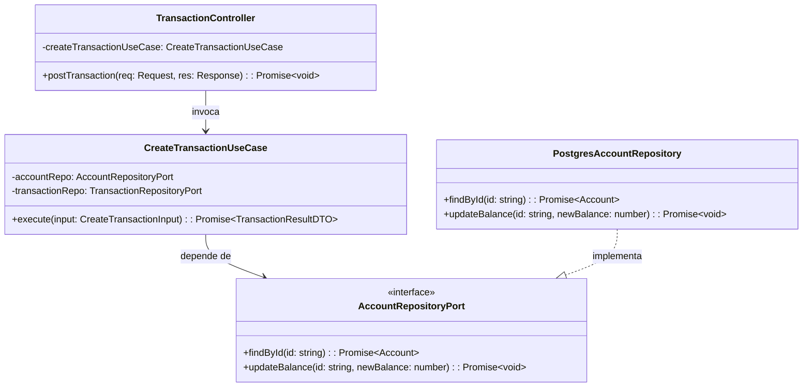
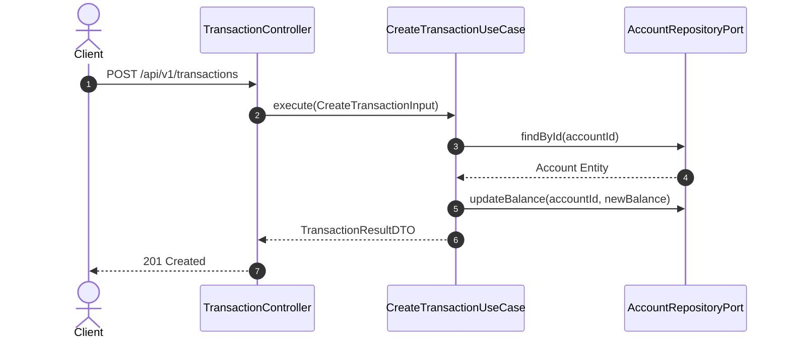

# Diseño de Componentes y Arquitectura de Software (Blueprint de Referencia)

## 1. Diagrama de Clases y Estructura en Capas (Mermaid)



### Invariantes de Dominio Formales (OCL)

```ocl
context Account
inv ValidEffectiveBalance:
    self.balance >= -self.overdraftLimit

inv FrozenAccountImmutable:
    (self.status = AccountStatus::FROZEN or self.status = AccountStatus::CLOSED) 
    implies self.balance = self.balance@pre
```

---

## 2. Diagrama de Secuencia Técnica (Mermaid)



---

## 3. Especificación de Componentes y Responsabilidades

### A. Capa de Transporte / Handlers (`src/presentation/` o `src/controllers/`)
- Valida el payload de entrada y traduce excepciones de dominio a códigos HTTP estándar (RFC 7807).

### B. Capa de Aplicación / Use Cases (`src/application/`)
- Orquesta el flujo de negocio operando exclusivamente contra interfaces abstractas (Puertos).

### C. Capa de Dominio (`src/domain/`)
- Entidades, Value Objects e invariantes de negocio libres de dependencias de infraestructura.

### D. Capa de Infraestructura / Repositorios (`src/infrastructure/`)
- Implementa los puertos concretos (ORM, clientes HTTP, brokers de mensajería).

---

## 📜 Historial de Revisiones (Últimos Cambios)

| Versión | Fecha | Requerimiento | Resumen del Cambio |
| :--- | :--- | :--- | :--- |
| `v0.1.0` | YYYY-MM-DD | `REQ-CORE-001` | Diseño inicial de capas, interfaces y puertos. |

> *Nota: Esta tabla mantiene una ventana deslizante de los últimos 3 cambios. Para el historial completo, consultar [`docs/backlog/changelog.md`](../backlog/changelog.md).*
