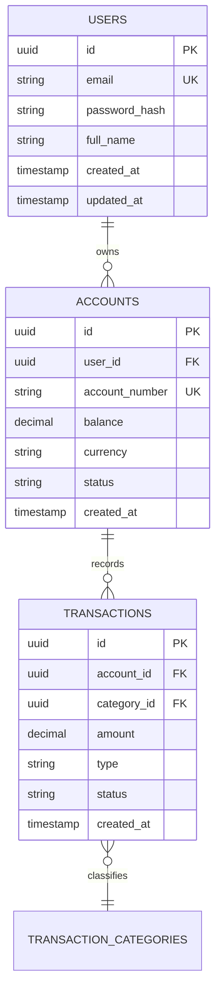

# Modelo de Base de Datos y Persistencia (Blueprint de Referencia)

## 1. Diagrama Entidad-Relación (Mermaid)

---

## 2. Diccionario de Datos

### Tabla: `users`
- **Descripción:** Almacena la identidad y credenciales de los usuarios registrados.
- **Motor / Tipo de almacenamiento:** PostgreSQL Heap Table / InnoDB.

| Campo | Tipo de Dato | Nulo | Por Defecto | Clave | Restricciones / Descripción |
| :--- | :--- | :--- | :--- | :--- | :--- |
| `id` | UUID | NO | `gen_random_uuid()` | PK | Identificador único universal |
| `email` | VARCHAR(255) | NO | - | UK | Correo electrónico único normalizado |
| `password_hash` | VARCHAR(255) | NO | - | - | Hash con Argon2id / bcrypt |
| `created_at` | TIMESTAMPTZ | NO | `CURRENT_TIMESTAMP` | - | Marca de tiempo UTC de creación |

#### Índices de `users`
- `pk_users`: `PRIMARY KEY (id)`
- `uq_users_email`: `UNIQUE INDEX (email)`

---

## 3. Estrategia de Migraciones y Rollback
- **Herramienta de Migración:** `[Prisma Migrate / TypeORM / Alembic / Flyway / Liquibase]`
- **Política de Cambios:** Toda modificación de esquema debe ser retrocompatible (*expand-and-contract*) y contar con su script de rollback.
- **Historial de Migraciones:**
  - `migrations/001_initial_schema.sql` (Rollback: `migrations/rollback/001_initial_schema_down.sql`)

---

## 📜 Historial de Revisiones (Últimos Cambios)

| Versión | Fecha | Requerimiento | Resumen del Cambio |
| :--- | :--- | :--- | :--- |
| `v0.1.0` | YYYY-MM-DD | `REQ-CORE-001` | Definición inicial del esquema de persistencia. |

> *Nota: Esta tabla mantiene una ventana deslizante de los últimos 3 cambios. Para el historial completo, consultar [`docs/backlog/changelog.md`](../backlog/changelog.md).*
