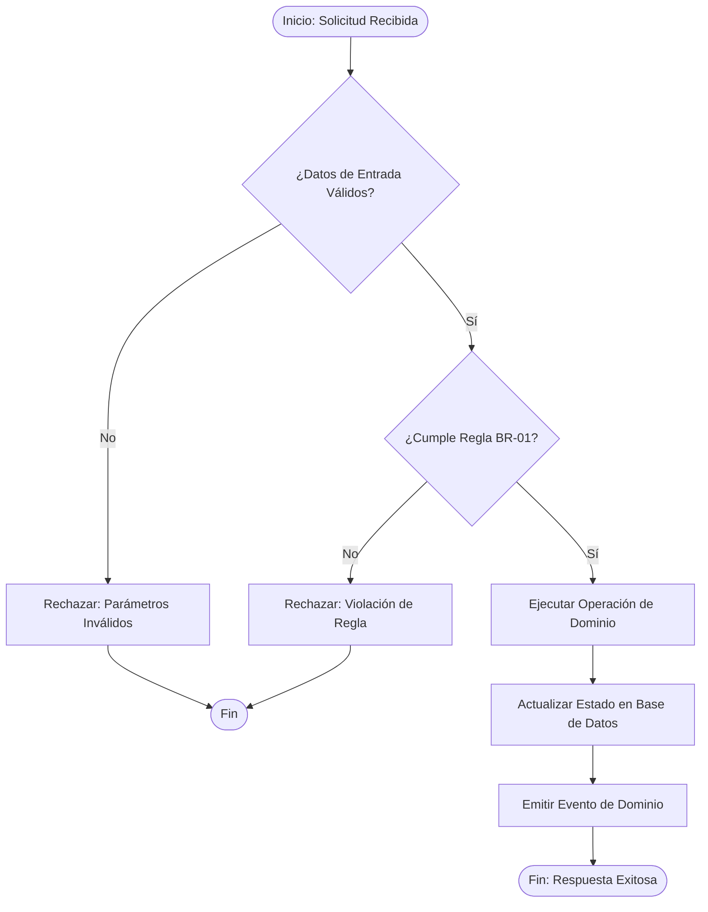

# UC-[DOMINIO]-[ID]: [Nombre del Caso de Uso]

## 1. Contexto & Actores
- **Dominio:** `[auth | billing | orders | core]`
- **Actor Principal:** `[Usuario Final | Administrador | Sistema Externo / Webhook | Worker / Cron]`
- **Disparador (Trigger):** `[Evento o acción que inicia el proceso]`
- **Precondiciones:**
  - El usuario debe estar autenticado en el sistema.
  - El recurso X debe encontrarse en estado `[ESTADO]`.

---

## 2. Diagrama del Proceso de Negocio (Mermaid)


---

## 3. Contrato de Entrada y Salida (Agnóstico de Framework)

### Inputs Requeridos:
| Campo | Tipo | Obligatorio | Validaciones / Restricciones |
| :--- | :--- | :--- | :--- |
| `userId` | UUID | Sí | Debe existir en el sistema y estar activo |
| `amount` | Decimal | Sí | Mayor a 0.00, hasta 2 decimales |
| `currency` | String | Sí | Código ISO 4217 (ej. 'USD', 'EUR') |

### Output Esperado:
| Campo | Tipo | Descripción |
| :--- | :--- | :--- |
| `transactionId` | UUID | Identificador único de la transacción generada |
| `status` | String | Estado final ('COMPLETED' o 'PENDING') |
| `processedAt` | ISO-8601 | Fecha y hora UTC del procesamiento |

---

## 4. Reglas de Negocio Asociadas

- **[BR-01] [Nombre de la Regla Invariante]:**
  - **Descripción:** Descripción explícita de la regla que el dominio debe garantizar.
  - **Contrato Formal OCL (Si aplica por heurística de complejidad):**
    ```ocl
    context [DominioService]::execute(input: [InputDTO])
    pre [NombrePrecondicion]:
        input.amount > 0 and self.balance >= input.amount
    post [NombrePostcondicion]:
        self.balance = self.balance@pre - input.amount
    ```

- **[BR-02] [Límite Operativo / Restricción de Estado]:**
  - **Descripción:** Restricción cuantitativa o condicional.
  - **Contrato Formal OCL:**
    ```ocl
    context [DominioEntity]
    inv [NombreInvariante]:
        self.status = Status::ACTIVE implies self.isBlocked = false
    ```

---

## 5. Efectos Secundarios y Cambios en el Sistema
- **Base de Datos Local:**
  - Se inserta un registro en la tabla `transactions`.
  - Se actualiza el saldo en la tabla `accounts`.
- **Sistemas Externos:**
  - Se invoca la API externa de Pasarela X vía webhook/HTTP.
- **Eventos Asíncronos:**
  - Se emite el evento `DomainEvent:TransactionCreated` a la cola de mensajería.

---

## 6. Flujos Alternativos y Excepciones
- **[EX-01] Saldo Insuficiente:** Si la cuenta no tiene fondos disponibles, abortar con error `INSUFFICIENT_FUNDS` y no persistir cambios.
- **[EX-02] Timeout de API Externa:** Si la pasarela externa no responde en 5 segundos, marcar transacción como `PENDING_RETRY` y programar tarea en cola de reintentos.

---

## 📜 Historial de Revisiones (Últimos Cambios)

| Versión | Fecha | Requerimiento | Resumen del Cambio |
| :--- | :--- | :--- | :--- |
| `v0.1.0` | YYYY-MM-DD | `REQ-[DOMINIO]-001` | Creación inicial del caso de uso. |

> *Nota: Esta tabla mantiene una ventana deslizante de los últimos 3 cambios. Para el historial completo de versiones anteriores, consultar [`docs/backlog/changelog.md`](../../backlog/changelog.md).*
