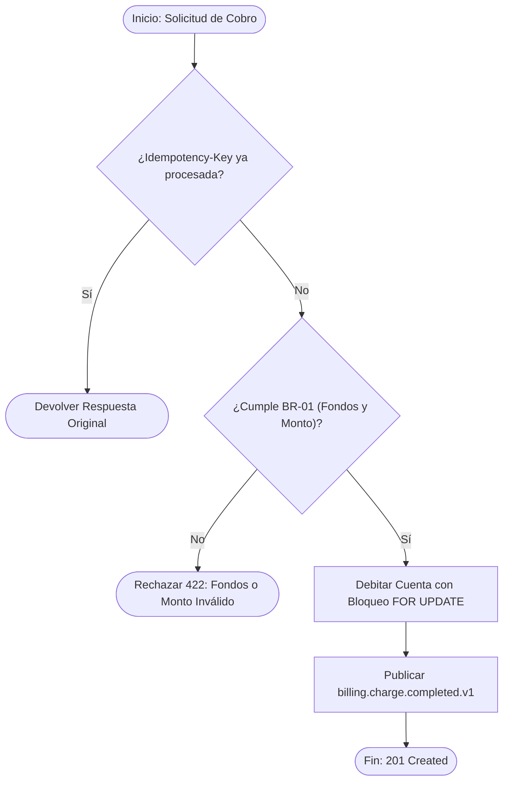

# UC-BILL-001: Cobro Transaccional con Idempotencia

## 1. Contexto & Actores
- **Dominio:** `billing`
- **Actor Principal:** `Comercio Autenticado`
- **Disparador (Trigger):** `POST /api/v1/charges con cabecera Idempotency-Key`
- **Precondiciones:**
  - El comercio cuenta con API Key activa y la cuenta origen tiene estado `ACTIVE`.

---

## 2. Diagrama del Proceso de Negocio (Mermaid)


---

## 3. Contrato de Entrada y Salida (Agnóstico de Framework)

### Inputs Requeridos:
| Campo | Tipo | Obligatorio | Validaciones / Restricciones |
| :--- | :--- | :--- | :--- |
| `accountId` | UUID | Sí | Cuenta existente en estado `ACTIVE` |
| `amount` | Decimal | Sí | Estrictamente positivo, máximo 2 decimales |
| `currency` | String | Sí | Código ISO 4217 (`USD`, `EUR`, `PEN`) |
| `idempotencyKey` | UUID | Sí | Clave única de deduplicación por 24h |

### Output Esperado:
| Campo | Tipo | Descripción |
| :--- | :--- | :--- |
| `chargeId` | UUID | Identificador inmutable del cargo |
| `remainingBalance` | Decimal | Saldo resultante tras aplicar el débito |
| `createdAt` | ISO-8601 | Fecha UTC de confirmación |

---

## 4. Reglas de Negocio Asociadas

- **[BR-01] Suficiencia de Fondos y Exactitud Monetaria:**
  - **Descripción:** El monto del cobro debe ser mayor que cero y la cuenta activa debe disponer de saldo suficiente para cubrir el cargo sin quedar en negativo.
  - **Contrato Formal OCL:**
    ```ocl
    context ChargeUseCase::execute(account: Account, amount: Decimal)
    pre ActiveAccountAndFunds:
        account.status = AccountStatus::ACTIVE and amount > 0 and account.balance >= amount
    post ExactBalanceMutation:
        account.balance = account.balance@pre - amount
    ```

---

## 5. Efectos Secundarios y Excepciones
- **[EX-01] `INSUFFICIENT_FUNDS` (HTTP 422):** Se aborta la transacción sin mutar saldo.
- **[EX-02] `IDEMPOTENCY_CONFLICT` (HTTP 409):** Misma `Idempotency-Key` reutilizada con distinto payload.

---

## 📜 Historial de Revisiones (Últimos Cambios)

| Versión | Fecha | Requerimiento | Resumen del Cambio |
| :--- | :--- | :--- | :--- |
| `v1.1.0` | 2026-10-31 | `REQ-BILL-001` | Especificación inicial con OCL e idempotencia. |

> *Nota: Esta tabla mantiene una ventana deslizante de los últimos 3 cambios. Para el historial completo, consultar [`docs/backlog/changelog.md`](../../backlog/changelog.md).*
