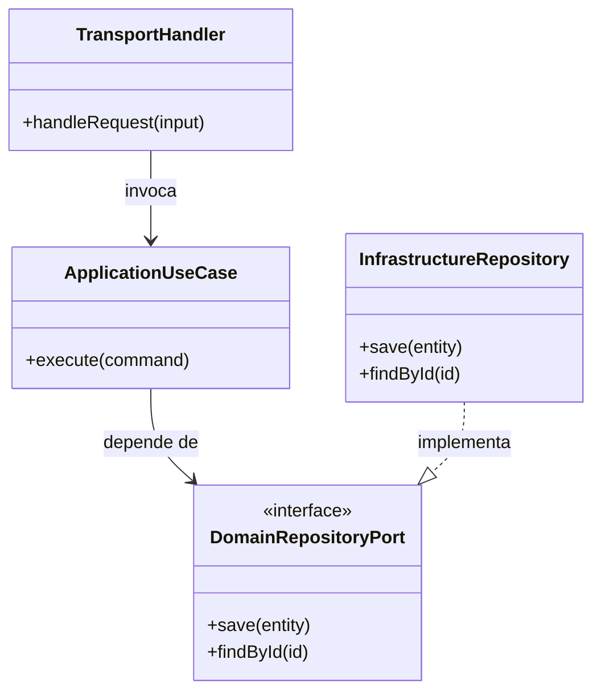
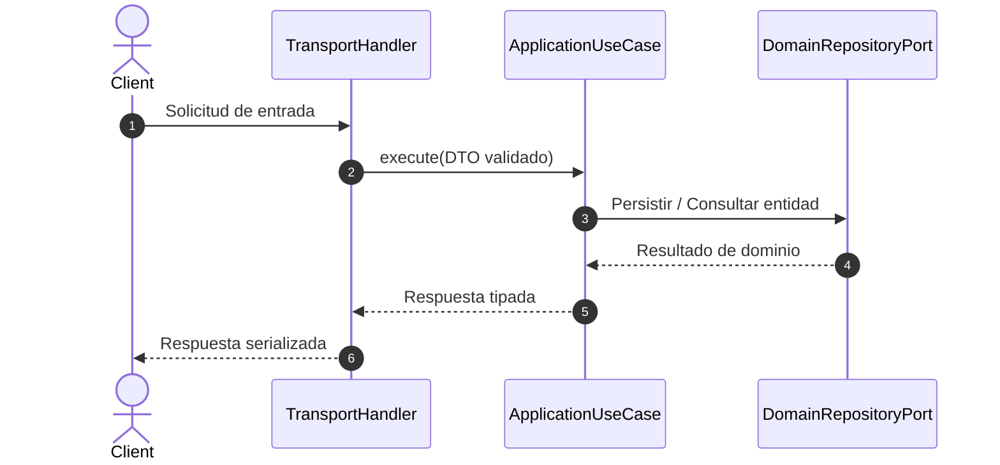

# Diseño de Componentes y Arquitectura — {{PROJECT_NAME}}

## 1. Diagrama de Clases y Estructura en Capas (Mermaid)

### Invariantes de Dominio Formales (OCL)
_Las invariantes `inv` de entidades complejas (saldos, cupos, máquinas de estado) se registrarán aquí siguiendo [`.spec/templates/ocl-guidelines.md`](../../.spec/templates/ocl-guidelines.md)._

---

## 2. Diagrama de Secuencia Técnica (Mermaid)

---

## 3. Especificación de Capas y Responsabilidades
- **Capa de Transporte / Entrada:** Validación de esquemas de borde y serialización HTTP/gRPC/CLI (`*{{SRC_EXT}}`).
- **Capa de Aplicación (Casos de Uso):** Orquestación transaccional de reglas de negocio sobre puertos abstractos.
- **Capa de Dominio:** Entidades, objetos de valor, eventos e invariantes puras sin acoplamiento a frameworks.
- **Capa de Infraestructura:** Adaptadores concretos de base de datos, caché y clientes externos.

---

## 📜 Historial de Revisiones (Últimos Cambios)

| Versión | Fecha | Requerimiento | Resumen del Cambio |
| :--- | :--- | :--- | :--- |
| `v{{CURRENT_VERSION}}` | {{TODAY}} | `INIT` | Inicialización limpia del diseño de componentes. |

> *Nota: Esta tabla mantiene una ventana deslizante de los últimos 3 cambios. Para el historial completo, consultar [`docs/backlog/changelog.md`](../backlog/changelog.md).*
