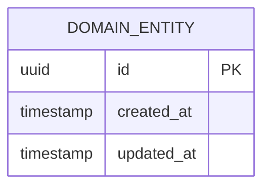

# Modelo de Base de Datos y Persistencia — {{PROJECT_NAME}}

## 1. Diagrama Entidad-Relación (Mermaid)

---

## 2. Diccionario de Datos

_Pendiente de modelar las entidades del proyecto. Consulta [`.spec/templates/_template_database.md`](../../.spec/templates/_template_database.md) al definir la primera tabla._

---

## 3. Estrategia de Migraciones y Rollback
- **Herramienta de Migración:** Por definir según el ORM/driver seleccionado en [`tech-stack.md`](./tech-stack.md).
- **Política de Cambios:** Toda migración debe ser retrocompatible y contar con procedimiento explícito de rollback.

---

## 📜 Historial de Revisiones (Últimos Cambios)

| Versión | Fecha | Requerimiento | Resumen del Cambio |
| :--- | :--- | :--- | :--- |
| `v{{CURRENT_VERSION}}` | {{TODAY}} | `INIT` | Inicialización limpia del modelo de persistencia. |

> *Nota: Esta tabla mantiene una ventana deslizante de los últimos 3 cambios. Para el historial completo, consultar [`docs/backlog/changelog.md`](../backlog/changelog.md).*
