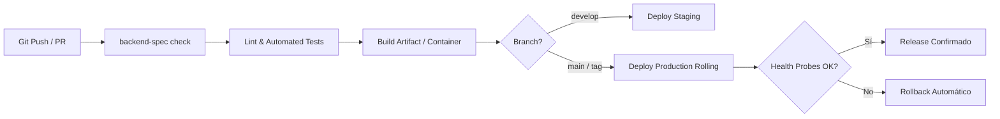

# Estrategia de Despliegue, Infraestructura y CI/CD — {{PROJECT_NAME}}

## 1. Diagrama de Flujo del Pipeline CI/CD (Mermaid)

---

## 2. Contenedorización y Ejecución
- Construcción reproducible (*multi-stage* si usa Docker) ejecutando con usuario sin privilegios (`nonroot`).

---

## 3. Variables de Entorno Requeridas

| Variable | Descripción | Ejemplo / Formato | Secreto? |
| :--- | :--- | :--- | :--- |
| `APP_ENV` | Entorno operativo | `development` / `production` | No |
| `PORT` | Puerto de escucha | `8080` | No |

> ⚠️ Ningún archivo `.env` con secretos reales debe versionarse en Git.

---

## 4. Health Checks y Rollout
- **Liveness Probe:** `GET /health/live`
- **Readiness Probe:** `GET /health/ready`
- **Estrategia de Rollout:** Rolling Update con rollback inmediato ante degradación de salud o tasa de errores 5xx > 1%.

---

## 📜 Historial de Revisiones (Últimos Cambios)

| Versión | Fecha | Requerimiento | Resumen del Cambio |
| :--- | :--- | :--- | :--- |
| `v{{CURRENT_VERSION}}` | {{TODAY}} | `INIT` | Inicialización de pipeline CI/CD y política de despliegue. |

> *Nota: Esta tabla mantiene una ventana deslizante de los últimos 3 cambios. Para el historial completo, consultar [`docs/backlog/changelog.md`](../backlog/changelog.md).*
